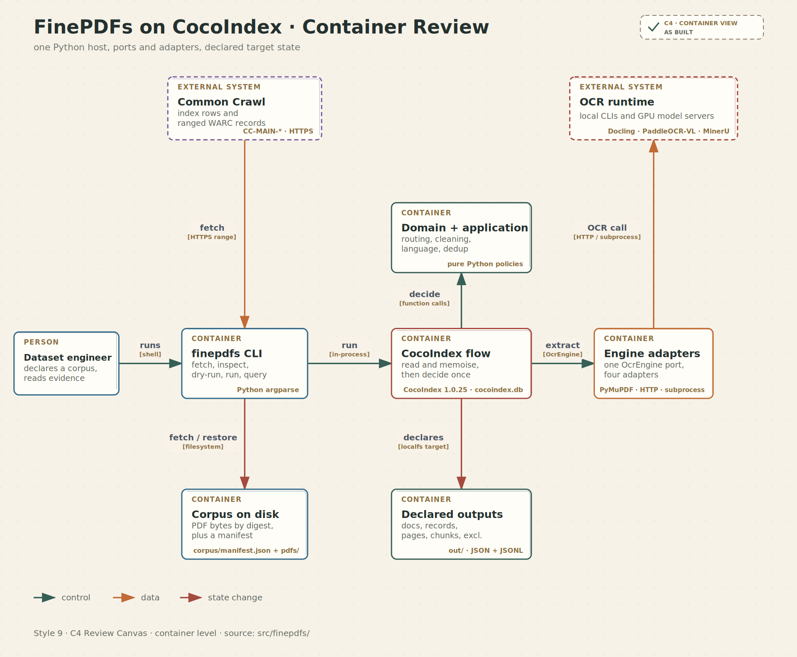
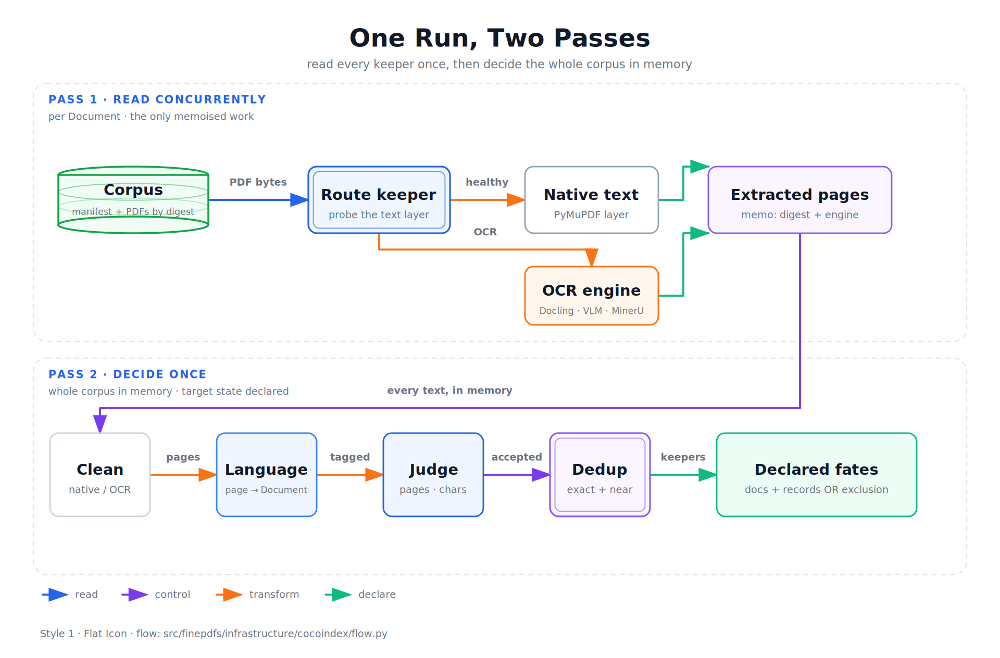
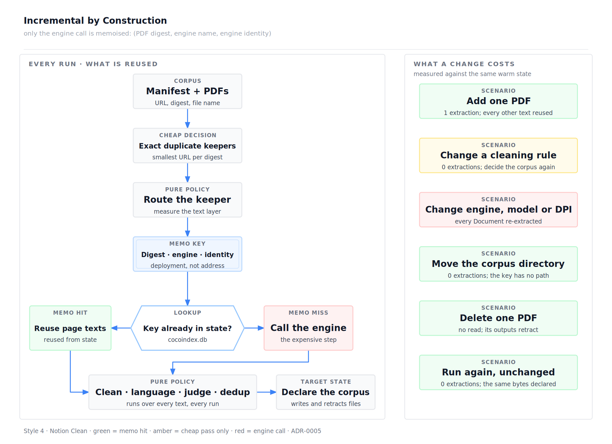
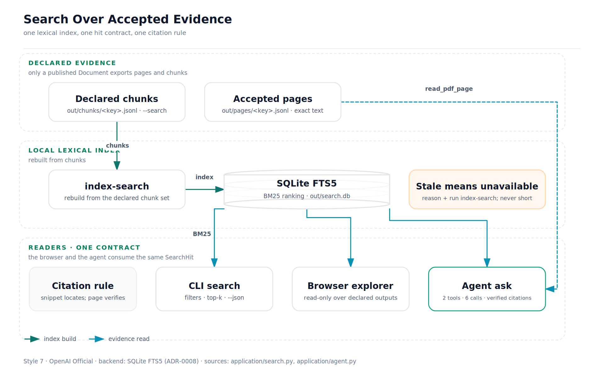
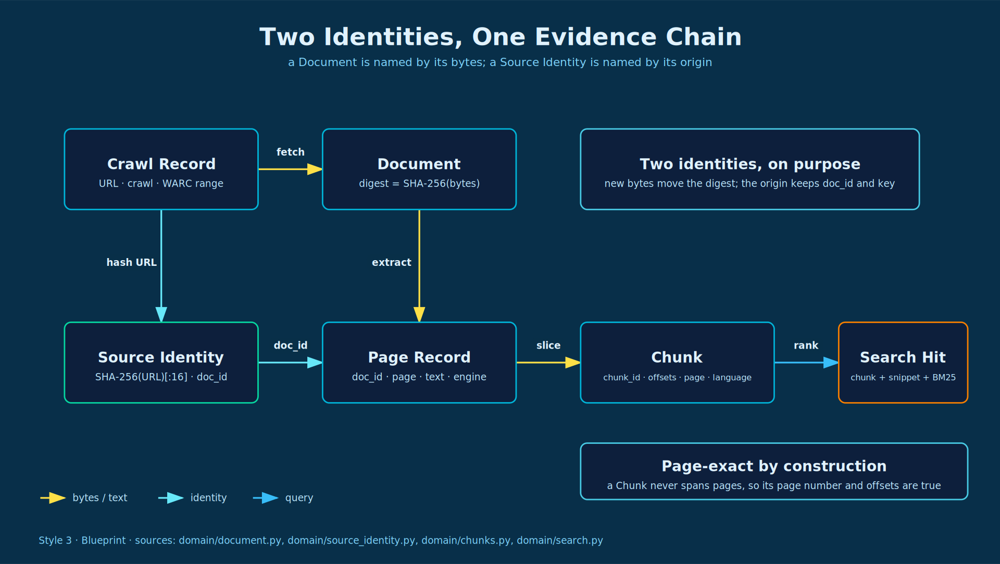

# Project diagrams

Five diagrams that explain the pipeline from the outside in. Each one is a validated SVG, a 1920px
PNG for reading, and a self-contained offline HTML page with pan, zoom and source copy.

Start with **1** for the shape of the system, then **2** for one run, **3** for why a re-run is cheap,
**4** for how accepted evidence is queried, and **5** for the identity rules that make citations and
replacements stable.

| # | Diagram | Answers | Style |
|---|---|---|---|
| 1 | [Architecture: containers and seams](#1-architecture) | What are the moving parts, what is a port, where does state live? | 9 · C4 Review Canvas |
| 2 | [One run, two passes](#2-one-run-two-passes) | What happens to a PDF from corpus to declared output? | 1 · Flat Icon |
| 3 | [Incremental by construction](#3-incremental-by-construction) | What re-runs when I change a rule, an engine, or the corpus? | 4 · Notion Clean |
| 4 | [Search over accepted evidence](#4-search-over-accepted-evidence) | How do search, the explorer and the agent read the same evidence? | 7 · OpenAI |
| 5 | [Two identities, one evidence chain](#5-two-identities-one-evidence-chain) | Why is a Document not a Source Identity, and what does a citation point at? | 3 · Blueprint |

## 1. Architecture



Open [interactive](html/01-architecture.html) · [SVG](svg/01-architecture.svg) · [spec](specs/01-architecture.json)

A container-level view: the CLI drives a CocoIndex flow, which asks pure domain/application policies
what to do and reaches OCR through one `OcrEngine` port. The four adapters are PyMuPDF, Docling,
PaddleOCR-VL and MinerU. Corpus files and declared outputs are the durable state; the memo table and
the current target live in `cocoindex.db`. Common Crawl and the OCR runtime are outside the boundary.

Evidence: `src/finepdfs/infrastructure/cocoindex/flow.py`, `src/finepdfs/domain/ports.py`,
`src/finepdfs/infrastructure/engines/`, `src/finepdfs/infrastructure/compute/`.

## 2. One run, two passes



Open [interactive](html/02-run-pipeline.html) · [SVG](svg/02-run-pipeline.svg) · [spec](specs/02-run-pipeline.json)

The flow reads every Document concurrently (the only memoised work), then hands every text to one
deciding pass that cleans, language-tags, judges and deduplicates the whole corpus. That second pass is
why near-duplicates can be decided in the flow itself instead of by a later command. The handoff
between the passes is in memory; every output is declared as target state.

Evidence: `src/finepdfs/infrastructure/cocoindex/flow.py`, `src/finepdfs/application/curate.py`,
`src/finepdfs/domain/ocr.py`, `src/finepdfs/domain/dedup.py`.

## 3. Incremental by construction



Open [interactive](html/03-incremental.html) · [SVG](svg/03-incremental.svg) · [spec](specs/03-incremental.json)

The memo key is `(PDF digest, engine name, engine identity)`. A cleaning-rule change re-runs only the
cheap deciding pass; an engine/model/DPI change re-extracts every Document; moving the corpus
re-extracts nothing because the key has no path in it. The right-hand cards are the useful cases to
keep in mind when changing the pipeline.

Evidence: ADR-0005, ADR-0007, `src/finepdfs/domain/document.py`,
`src/finepdfs/infrastructure/engines/stable_identity.py`.

## 4. Search over accepted evidence



Open [interactive](html/04-search-evidence.html) · [SVG](svg/04-search-evidence.svg) · [spec](specs/04-search-evidence.json)

A run that enables search declares chunks as well as pages. `index-search` builds SQLite FTS5 from
the declared chunk set and records that set's fingerprint. On every read, a different fingerprint
means the index is stale, and the answer is an explicit `available: false` with the command to run —
never a short list of hits. `search`, `explore` and `ask` all consume the same `SearchHit`; the agent's
citations are verified against the exact accepted page text, not the snippet.

Evidence: `src/finepdfs/application/search.py`, `src/finepdfs/domain/search.py`,
`src/finepdfs/infrastructure/search/sqlite_fts.py`, `src/finepdfs/application/agent.py`, ADR-0008.

## 5. Two identities, one evidence chain



Open [interactive](html/05-identity-model.html) · [SVG](svg/05-identity-model.svg) · [spec](specs/05-identity-model.json)

A Document is identified by the digest of its bytes; a Source Identity is `sha256(source URL)[:16]`.
Replacing the bytes changes the Document and its digest but not the Source Identity, so the same
`doc_id` and output key are rewritten in place. A Page Record keeps the original 1-based page number;
a Chunk never spans pages, so both its page number and its character offsets are exact; a Search Hit
adds only a snippet and a score to that Chunk.

Evidence: `src/finepdfs/domain/document.py`, `src/finepdfs/domain/source_identity.py`,
`src/finepdfs/domain/publishing.py`, `src/finepdfs/domain/chunks.py`, `src/finepdfs/domain/search.py`.

## Validation and regeneration

Every artifact passes the skill's `check` gate (XML, markers, collisions, geometry, composition) with
`quality_profile: "showcase"` and `text_policy: "strict"`; the layout reports contain no truncated
labels. The PNGs are 1920px wide.

Regenerate from the repository root:

```bash
SKILL=/home/ubuntu/.agents/skills/fireworks-tech-graph/scripts/fireworks.py
# architecture
python3 "$SKILL" render architecture docs/diagrams/specs/01-architecture.json docs/diagrams/svg/01-architecture.svg
# data flow
python3 "$SKILL" render data-flow docs/diagrams/specs/02-run-pipeline.json docs/diagrams/svg/02-run-pipeline.svg
# flow chart
python3 "$SKILL" render flowchart docs/diagrams/specs/03-incremental.json docs/diagrams/svg/03-incremental.svg
# search data flow
python3 "$SKILL" render data-flow docs/diagrams/specs/04-search-evidence.json docs/diagrams/svg/04-search-evidence.svg
# identity model
python3 "$SKILL" render architecture docs/diagrams/specs/05-identity-model.json docs/diagrams/svg/05-identity-model.svg
# gates and exports
for svg in docs/diagrams/svg/*.svg; do
  python3 "$SKILL" check "$svg"
  python3 "$SKILL" export-png "$svg" "docs/diagrams/png/$(basename "${svg%.svg}").png" --width 1920
  python3 "$SKILL" export-html "$svg" "docs/diagrams/html/$(basename "${svg%.svg}").html"
done
```

Visual review status: draft renders of diagrams 1–3 were inspected at raster level during authoring, and
diagram 4 was inspected before its final spacing fix. Diagram 5, and the final rasters after the last
edits, have passed the geometric and text-completeness gates but were not re-inspected at raster level
because the vision provider hit its usage limit. A passing command is not a visual quality verdict; a
final look at the PNGs before publishing them widely is still worthwhile.
